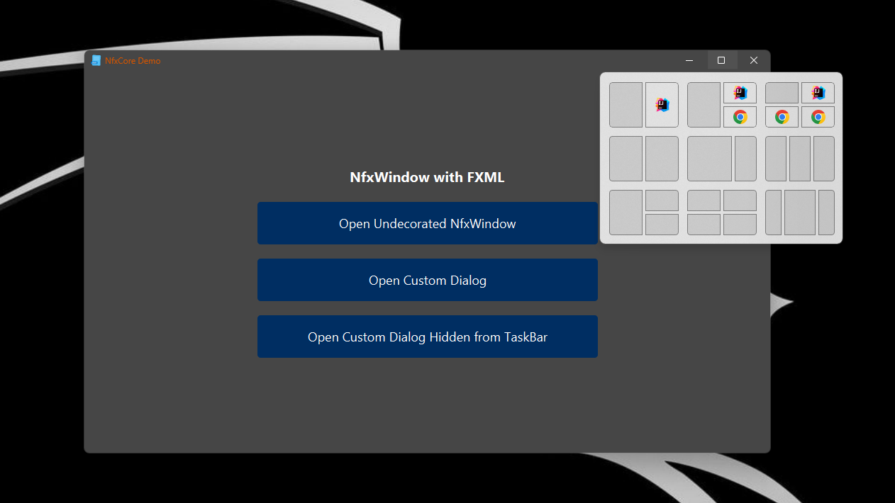
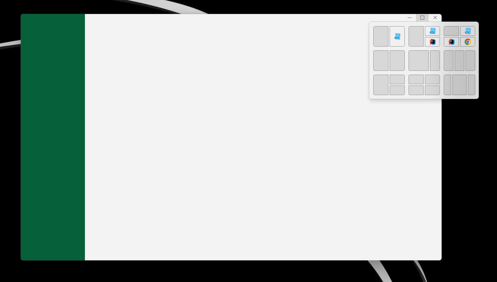
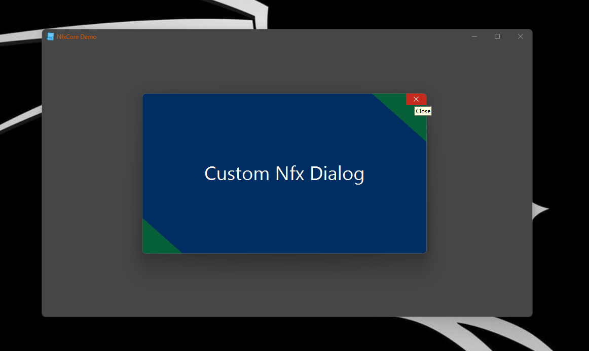
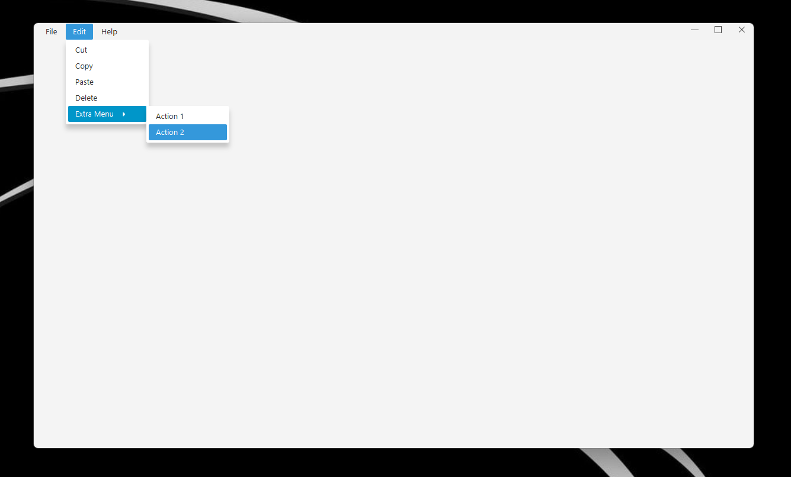

# NFX Library for Windows

**nfx-core v1.0.5** is a JavaFX/JNI library for Windows 10/11 that enables fully custom, native-feeling window chrome with title bar customization, window controls, and native frame behavior.

## Requirements

| Requirement | Version |
|-------------|---------|
| **OS** | Windows 10 or later |
| **Java** | 25+ |
| **JavaFX** | 21+ |
| **DPI** | Per-monitor DPI awareness (PMv2) recommended |

## Features

### Native Windows Integration

- **Native Hit Testing** - System menu, move/resize, and drag zones behave like real Windows windows
- **Windows 11 Snap Layouts** - Full snap-layout support with automatic fallback on Windows 10
- **Native Tooltips** - Uses Windows tooltips for consistent look & feel
- **DWM Customization** - Title bar color, caption color, corner preference, and border color

### JavaFX Integration

- **Full Customization** - All decoration elements styled and controlled from JavaFX
- **CSS Pseudo-Classes** - Native hover states exposed via `:ht-close`, `:ht-max`, `:ht-min`, `:ht-client`
- **Observable Properties** - All DWM attributes are bindable JavaFX properties
- **Thread-Safe** - Proper synchronization between native and FX threads

## Architecture

```
┌─────────────────────────────────────────────────────────────┐
│                        Your Application                      │
├─────────────────────────────────────────────────────────────┤
│  NfxStage (concrete)                                        │
│    └── Hit spot management, control registration            │
├─────────────────────────────────────────────────────────────┤
│  AbstractNfxUndecoratedWindow                               │
│    └── JNI callbacks, state sync, native hooks              │
├─────────────────────────────────────────────────────────────┤
│  NfxWindow                                                  │
│    └── DWM properties (title bar, caption, corners, border) │
├─────────────────────────────────────────────────────────────┤
│  NfxUtil + Native DLL                                       │
│    └── JNI bridge, DWM API calls, WndProc subclassing       │
└─────────────────────────────────────────────────────────────┘
```

## Quick Start

### 1. Extend NfxStage

```java
public class MyWindow extends NfxStage implements Initializable {
    @FXML private MenuBar menuBar;
    @FXML private TextField searchBox;
    @FXML private Button closeBtn, maxBtn, minBtn;

    @Override
    protected double getTitleBarHeight() {
        return 40;
    }

    @Override
    public void initialize(URL url, ResourceBundle rb) {
        // Register interactive controls in title bar (receive mouse events instead of triggering drag)
        addClientAreas(menuBar, searchBox);

        // Register window control buttons
        setCloseControl(closeBtn);
        setMaxControl(maxBtn);
        setMinControl(minBtn);
    }
}
```

### 2. Customize Window Appearance

```java
MyWindow window = new MyWindow();

// Title bar background color
window.setTitleBarColor(Color.web("#1a1a2e"));

// Title text color
window.setCaptionColor(Color.WHITE);

// Window corner style (Windows 11)
window.setCornerPreference(CornerPreference.ROUND);

// Window border color
window.setWindowBorder(Color.web("#333333"));

window.show();
```

### 3. Style with CSS

```css
/* Close button - Windows red on hover */
.close-btn:ht-close {
    -fx-background-color: #C42B1C;
}
.close-btn:ht-close .icon {
    -fx-fill: white;
}

/* Maximize/Minimize hover effect */
.window-btn:ht-max,
.window-btn:ht-min {
    -fx-background-color: rgba(150, 150, 150, 0.32);
}

/* Client area hover (interactive controls in title bar) */
.title-control:ht-client {
    -fx-opacity: 1.0;
}
```

## API Reference

### NfxWindow Properties

| Property | Type | Description |
|----------|------|-------------|
| `titleBarColor` | `Color` | Title bar background color (DWMWA_CAPTION_COLOR) |
| `captionColor` | `Color` | Title text color (DWMWA_TEXT_COLOR) |
| `cornerPreference` | `CornerPreference` | Corner rounding style (Windows 11) |
| `windowBorder` | `Color` | Window border color (DWMWA_BORDER_COLOR) |

### NfxStage Methods

| Method | Description |
|--------|-------------|
| `addClientAreas(Region...)` | Register interactive controls in title bar (receive mouse events instead of triggering window drag) |
| `removeClientAreas(Region...)` | Unregister client-area regions |
| `setCloseControl(Control)` | Assign the close button control |
| `setMaxControl(Control)` | Assign the maximize/restore button control |
| `setMinControl(Control)` | Assign the minimize button control |
| `getTitleBarHeight()` | Return the title bar height in DIP (override this) |

### AbstractNfxUndecoratedWindow Properties

| Property | Type | Description |
|----------|------|-------------|
| `windowState` | `WindowState` | Current window state (NORMAL, MAXIMIZED, MINIMIZED, FULL_SCREEN) |
| `hideFromTaskBar` | `boolean` | Whether to hide window from taskbar |

### CornerPreference Enum

| Value | Description | DWM Constant |
|-------|-------------|--------------|
| `DEFAULT` | System default | DWMWCP_DEFAULT |
| `NOT_ROUND` | Square corners | DWMWCP_DONOTROUND |
| `ROUND` | Standard rounded (8px) | DWMWCP_ROUND |
| `ROUND_SMALL` | Small rounded | DWMWCP_ROUNDSMALL |

### CSS Pseudo-Classes

| Pseudo-Class | Applied When |
|--------------|--------------|
| `:ht-close` | Native hover over close button region |
| `:ht-max` | Native hover over maximize button region |
| `:ht-min` | Native hover over minimize button region |
| `:ht-client` | Native hover over client area region |

## Window State Management

```java
// Listen for state changes
window.windowStateProperty().addListener((obs, oldState, newState) -> {
    switch (newState) {
        case MAXIMIZED -> updateMaximizeIcon(true);
        case NORMAL -> updateMaximizeIcon(false);
        case MINIMIZED -> { /* minimized */ }
        case FULL_SCREEN -> { /* fullscreen */ }
    }
});

// Programmatic state changes
window.setWindowState(WindowState.MAXIMIZED);
window.setWindowState(WindowState.NORMAL);
```

## HitSpot System

HitSpots define interactive regions in the title bar for native Windows integration:

```java
// Manual HitSpot creation (advanced usage)
HitSpot customSpot = HitSpot.builder()
    .window(this)
    .control(myCustomButton)
    .systemMenu(true)  // or .close(true), .maximize(true), .minimize(true)
    .build();

// Listen for native hover
customSpot.hoveredProperty().addListener((obs, was, is) -> {
    myCustomButton.pseudoClassStateChanged(PseudoClass.getPseudoClass("native-hover"), is);
});
```

## Native Library

The native DLL is automatically extracted to `~/.nfx-libs/` on first use:

```
~/.nfx-libs/nfx-core-win64-1.0.5.dll
```

### Building Native Code

See `nfx-core/src/native/README.md` for build instructions.

## Examples

See `demo/src/main/java/xss/it/demo/Demo.java` for an interactive demonstration.

## Screenshots

| Description | Preview |
|-------------|---------|
| NfxWindow Example |  |
| Custom Window (AbstractNfxUndecoratedWindow) |  |
| Custom Dialog (taskbar hide/show) |  |
| MenuWindow Demo |  |

## Version History

### 1.0.5
- **Thread Safety Fixes**: Proper synchronization for JNI callbacks and property access
- **Memory Leak Fixes**: Listener cleanup on window hide/show cycles
- **Bug Fixes**: Color conversion, directory creation, resource handling
- **Documentation**: Comprehensive Javadoc for all public APIs

### 1.0.4
- Minor fixes and improvements

### 1.0.3
- Initial public release

## Troubleshooting

### Window controls not responding to hover
Ensure you've registered controls with `setCloseControl()`, `setMaxControl()`, `setMinControl()`.

### Snap Layouts not appearing (Windows 11)
Verify the maximize button is registered and its bounds are correct. Call `refresh()` after layout changes.

### Native library not loading
Check that `~/.nfx-libs/` is writable and not blocked by antivirus software.

## Support

When reporting issues, please include:
1. Windows version (10/11 + build number)
2. Java/JavaFX version
3. Minimal reproducible code example
4. Stack trace (if applicable)

## License

MIT License - Free for any use, commercial or personal.

See [LICENSE](LICENSE) file for details.
